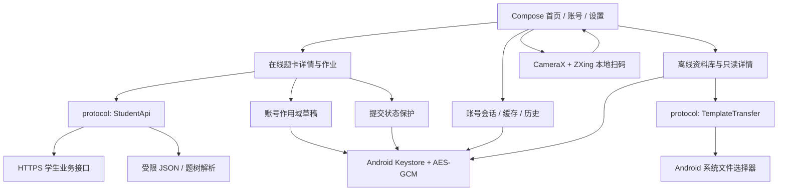

# 结构与数据流

本工程包含 Android 应用和纯 JVM 协议模块。完整构建方法见 [BUILDING.md](../BUILDING.md)，业务差异见[功能对照](feature-comparison.md)，实际执行范围见 [TESTING.md](../TESTING.md)。

## 模块职责

- [app](../app/build.gradle.kts) 管理 Compose 导航、Material 3 主题、Android 生命周期、系统权限、相机和文件选择器。数据仓库只保存本版沙箱内的数据。
- [protocol](../protocol/build.gradle.kts) 定义模型、固定协议、请求摘要、密文处理、响应与导入预算、答案字母提取和 HTML 导出。它不依赖 Android，可用本机合成夹具测试。
- [构建脚本](../tools/build-android.py) 设置实际主机工具与外部签名环境；[产物核验](../tools/verify-apks.py) 检查三个 APK；[交付脚本](../tools/package-delivery.py) 只打包已提交源码与核验后未改变的产物。

## 两种题卡来源

在线题卡与账号绑定，网络失败时可读取该账号的加密缓存。账号切换会取消过期加载，界面用账号作用域检查结果后才更新。

离线导入和合成示例独立于账号。导入按白名单重建模型，移除旧作答与账号元数据；只读界面没有作业入口，也不加载远端题图。离线文件可以导出为净化后的 HTML，不能通过导入内容伪造在线提交上下文。

## 草稿与不可逆请求

草稿读取成功后才启用自动保存，避免读取失败时覆盖旧内容。编辑有防抖写入，受控返回与后台事件尝试刷新当前快照；同一把协程互斥锁序列化写入和提交后的清除。选择的照片只有在取得持久读取权限后才加入草稿；授权处理期间禁用提交与受控返回，防止确认快照遗漏仍在准备的图片。

最终确认取得不可变作答快照。照片预处理和上传完成后，应用先持久写入本机未知状态，再发送答卷。答卷请求为一次性 body，禁用自动重试与重定向。协程取消只请求取消网络；实际 OkHttp 终止回调才释放进程内执行保护。本机未知标记保留到服务端明确成功，或用户人工核实后确认解锁。上传和答卷是两个请求，不构成事务；上传成功不代表作业提交成功。

## 预算与边界

协议和导入均限制解压后字节数、JSON 深度、题树深度与题目数量。离线库还有总容量和条目数限制。题目富文本由原生 TextView 处理有限 HTML，无法提供浏览器级 CSS、MathML 或 JavaScript 公式排版。

这些机制已存在于源码，但 Android Keystore、URI 授权、后台刷新与相机行为仍需在实际设备验证。主机 JVM 测试和 APK 验签的适用范围见[测试报告](../TESTING.md)，不得据此推断全部运行时路径已通过。
